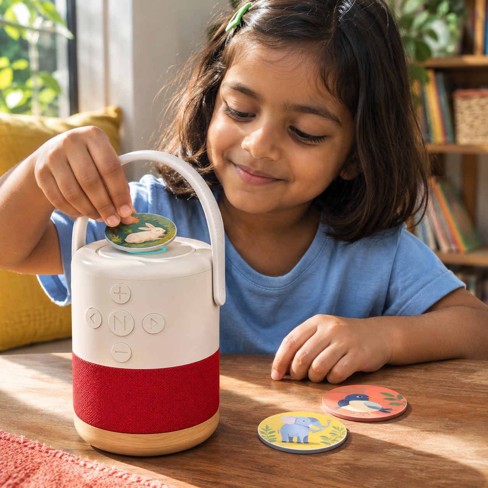
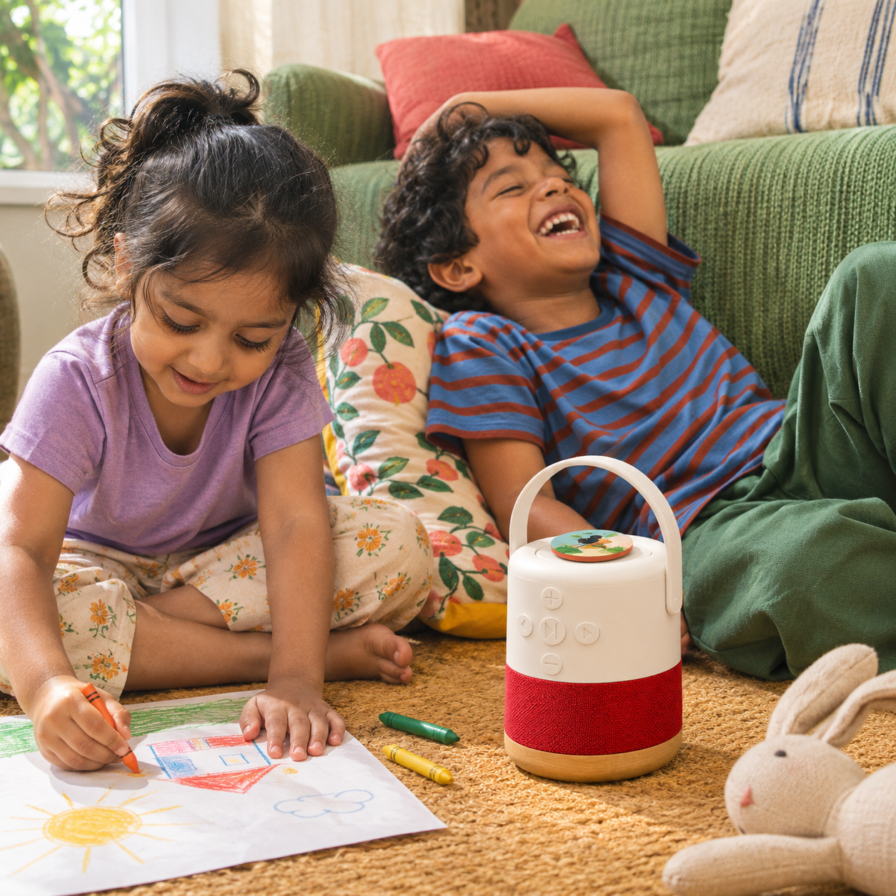
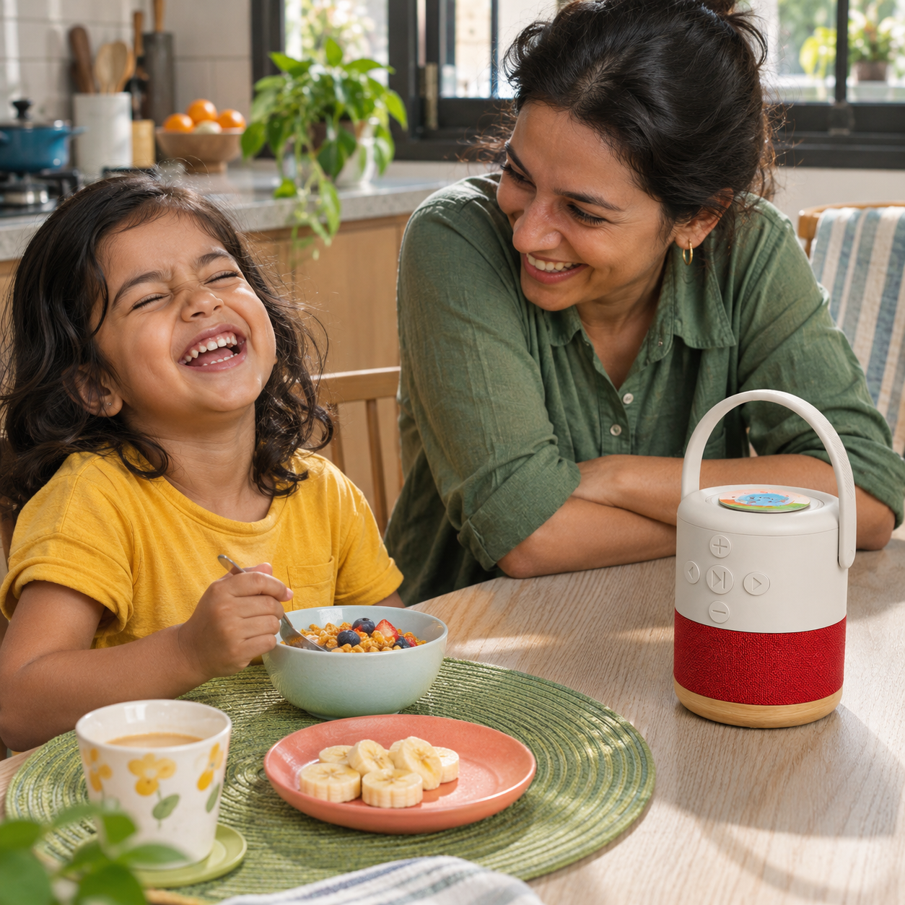
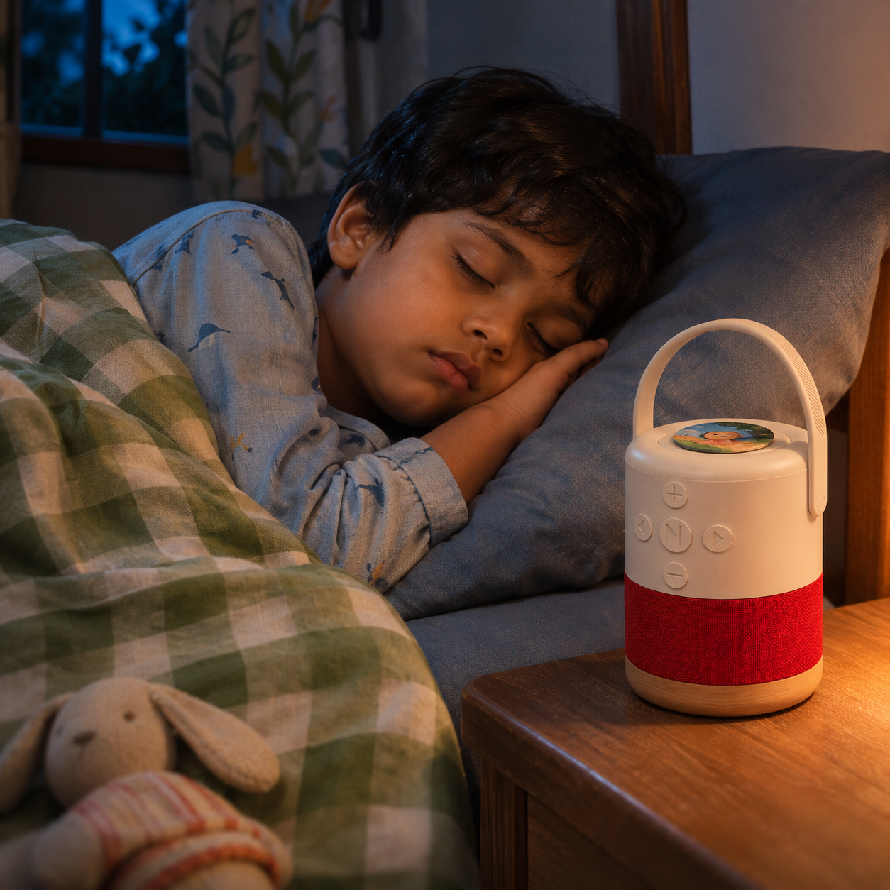

# Hey Kahani photography style guide

**Direction approved on November 20, 2026.**

Photograph Indian children in candid everyday moments, with warm light and
playful colours. The feeling is close, relaxed and full of life: a child choosing
a story, siblings listening while they draw, an unexpected giggle at breakfast,
or the quiet at bedtime. Let the child's experience lead the photograph.

Use this guide for future photography briefs, image generation and image
selection. It is the current photography reference alongside
[the project design reference](../design.md#photography-and-product-imagery).

## Visual references

The four generated concepts below establish the approved direction. They are
style references, not final merchandise photographs or specifications for
printed Koel artwork. Use the manufacturing references for product geometry.

| Choosing a story | Stories on the floor |
| --- | --- |
|  |  |
| Close to the hands and face; absorbed attention; a small, unforced smile. | Different activities and emotions in one shared moment; colourful, tactile surroundings. |

| Breakfast giggles | Bedtime wind-down |
| --- | --- |
|  |  |
| A spontaneous reaction during an ordinary routine; warmth between parent and child. | The same domestic honesty in a quieter register; soft practical light and readable shadows. |

## Casting and expression

Cast Indian children, with the current storefront's core ages of 3–6 in mind.
Show a natural range of skin tones, facial features and hair textures across a
set. Give children individual faces and personalities. Parents and siblings
belong in scenes where they have a real role in the moment.

Use everyday clothes, natural hair and relaxed posture. Indian identity should
come through the people and their lives. Cultural details can appear when they
belong to the home or activity; ceremonial dress and decorative cultural props
are not defaults.

Expressions can be curious, absorbed, amused, peaceful or sleepy. Catch the
small changes between actions. Avoid repeated toothy grins, eye contact with
the camera and children holding the product up for a sales demonstration.

## Everyday moments

Each photograph needs one clear action or reaction. Build around activities a
child could continue doing if the photographer left the room.

| Moment | What to capture | What makes it feel candid |
| --- | --- | --- |
| Choosing a story | A hand selecting or lowering a circular Koel | The child's eyes follow the action; the other hand rests naturally |
| Independent listening | Drawing, building or resting while a story plays | Attention stays on the activity rather than the camera |
| Shared listening | Siblings occupying the same space in different ways | Natural gaps, uneven poses and different expressions |
| Family routine | Breakfast, a quiet afternoon or getting ready for bed | An interrupted action, a glance or an unexpected laugh |
| Bedtime | A relaxed child beneath a soft quilt | Low light, loose hands and an undisturbed expression |

Vary the emotional pace across a set. A focused child and a quiet bedtime
photograph belong beside laughter. Keep gestures physically plausible and
avoid arranging every person and object toward the lens.

## Light and colour grade

Daytime photographs use soft directional window light or gentle sunlight.
Let light describe skin, cotton, wood and the Player's fabric speaker band.
Keep some shadow and depth instead of flattening everything with bright fill.

Warmth should come from the light and setting. Keep whites believable and brown
skin tones natural; avoid a yellow or sepia wash. Use moderate contrast, soft
highlight roll-off and visible texture. Avoid plastic skin, aggressive
sharpening, heavy grain, exaggerated background blur and cinematic colour casts.

At bedtime, use a warm bedside lamp or another plausible household light, with
subtle dusk fill where appropriate. Let the room feel dark while retaining
detail in the child's face and the product. The Player is not the light source;
do not invent a glowing body or a night-light function.

## Playful colour and materials

Use colour through cotton clothes, cushions, quilts, rugs, drawings and a few
ordinary objects. A natural wood or light wall can give stronger colours room.
Keep the scene lively without making every object compete for attention.

Draw styling colours from the existing brand palette. These values guide hue
selection; photographed fabrics retain their natural tonal variation under light.

| Colour family | Brand reference | Useful applications |
| --- | --- | --- |
| Warm cream and wood | Kesar Sand #FFF1D6; Coconut Husk #E6CEAD | Walls, cotton, rugs and furniture |
| Soft blue | Sky Blue #63C3FE; Monsoon Blue #2578B7 | T-shirts, bedding and cushions |
| Warm yellow | Mango Yellow #FECB74 | Clothing and small textile accents |
| Green | Parrot Green #2B9863 | Upholstery, trousers and woven textiles |
| Gentle purple | Lavender tea #D6C9E4 | A top, blanket or cushion |
| Warm orange | Marigold Orange #FF5D27 | A restrained stripe or small object |
| Product red | Gulab Red #D3000A | The Player's woven speaker band |

Prefer cotton, linen, knit, woven rugs, matte surfaces and real wood. A few
creases, flyaway hairs or crayons make a room feel occupied. Keep clutter
purposeful. Avoid uniformly beige rooms, neon saturation and spotless showroom
sets. An incidental pattern is welcome; matching every textile is unnecessary.

## Framing and camera position

Get close enough to read the child's expression and the action. Work at floor,
table or child eye level, or use a gentle standing angle when the routine calls
for it. Top-down framing suits hands and activities; it should not become the
default viewpoint for every scene.

As production guidance, a 35–50 mm equivalent lens gives a useful starting
point for domestic scenes. Keep perspective believable and avoid making nearby
hands or the Player look oversized. Use enough depth of field for the gesture
and product to remain readable, with a softly described environment behind them.

Compose with natural asymmetry. The Player can occupy a foreground or bedside
position without dominating every image. Keep faces, meaningful hand gestures
and the product's recognisable silhouette clear. Allow negative space when a
specific placement needs copy; other photographs can stay intimate and full.

## Product identity

Use the actual Kahani Player and circular Koel format in every product scene.

- Cream or off-white cylindrical body, rounded top and arch carry handle.
- Five physical controls: plus above; previous, play/pause and next across the
  middle; minus below.
- Gulab Red #D3000A woven speaker band above a light wood-toned base. Preserve
  the cream housing; the whole device is not red.
- A recessed circular top plate. A Koel rests flat on top; there is no card slot.
  An empty plate has no story illustration printed onto it.
- Flat circular illustrated Koel discs, with physically plausible thickness
  and scale. Preserve actual supplied story artwork when it is available.

Keep materials, proportions, perspective and contact shadows consistent with
the room. The product should sit on a real surface, not float or resemble a
pasted studio cutout. Core child-listening scenes stay free of phones and
tablets. A separate parent companion-app brief can depict the grown-up's app
role without making the child's listening experience screen based.

Use [the manufacturing angle](product-reference/manufacturing-front-angle.png)
and [front view](product-reference/manufacturing-front.png) for geometry. Their
grey sample band must become Gulab Red in production-facing concepts.
[The production-colour concept](../frontend/assets/images/player-production-v2.png)
helps show that colour application; it is a concept recreation.

## Reusable generation brief

Attach one product reference and one or two of the approved style photographs.
Label their roles: product references control geometry and colour application;
style references control light, framing, texture and emotion. Describe a new
scene rather than asking for a face swap or a copy of the reference room.

Use this master brief, then add the product details and a scene starter below.

~~~text
Create one photoreal editorial lifestyle photograph for Hey Kahani.
Show Indian children in a candid everyday moment in a contemporary lived-in
home. Use individual faces, natural brown skin tones, ordinary cotton clothes,
relaxed posture and an expression specific to the activity. Let the child lead
the moment; nobody looks at the camera or presents the product to it.

Use soft directional natural light, believable warm highlights, gentle shadows
and neutral whites. Bring playful colour through a few tactile textiles and
ordinary objects in the Hey Kahani palette. Keep natural skin, hair and fabric
texture. Use intimate framing and believable perspective, with enough depth
of field to read the action and the Kahani Player. For bedtime, replace daylight
with warm practical lamp light and subdued dusk fill.

Preserve the supplied Kahani Player reference: cream cylindrical body, rounded
top, arch handle, five controls, Gulab Red #D3000A woven speaker band and light
wood base. Koels are circular illustrated discs placed flat on the top plate.
Keep realistic scale, materials, contact shadows and perspective.

Scene: [one activity, the people involved, an expression, a few relevant props,
camera position and intended crop].
Deliver a complete photographic frame without text, borders, graphic masks
or watermarks.
~~~

### Scene starters

- **Choosing a story:** an Indian girl around five follows her hand as she
  lowers a circular Koel onto the Player at a wooden activity table. Small
  pleased smile, window light, one colourful cushion, close table-level view.
- **Stories on the floor:** two Indian siblings listen beside a green sofa.
  One draws while the other laughs against a cushion. Player upright on the
  rug, a few crayons, camera close to floor level.
- **Breakfast giggles:** an Indian child laughs mid-spoonful as their mother
  reacts naturally beside them. Player on the table, a small breakfast setting,
  gentle standing angle and soft morning light.
- **Bedtime:** an Indian child sleeps on their side beneath a cotton quilt.
  Player on a bedside table, warm off-frame lamp light, muted blue bedding and
  readable low-light textures.

### Exclusions

~~~text
Avoid posed stock-photo smiles, repeated generic faces, waxy skin, malformed
hands, exaggerated proportions, oversized or floating products, showroom
interiors, costume-based cultural shorthand, neon saturation, an overall amber
filter, harsh flash, heavy grain, extreme bokeh, invented product features,
rectangular story cards, competitor devices, child-facing screens, text overlays
and watermarks.
~~~

## Selection and delivery

Review each image for the approved casting, a believable everyday moment,
warm light and playful colour. Then check hands, gaze, scale, product geometry,
circular Koels and the way every object meets its surface. Select a varied set
that still feels like the same campaign.

Keep complete uncropped masters. Prepare placement crops separately so faces,
hands and product identity survive both wide and narrow layouts. Apply website
masks in the presentation layer rather than baking shapes into the master.

For new final assets intended for large web placements, target at least 2400 px
on the long edge where the source allows, with an sRGB delivery export. Retain
the native original and record its dimensions; upscaling does not create extra
captured detail. The four direction samples are 1254 × 1254 px.

Save the exact prompt and input-reference roles with generated work. Identify
generated concepts as such in asset records. Approval of the visual direction
does not turn a recreated device or illustrative disc face into verified
merchandise imagery.

## Sources

- User approval on November 20, 2026: Indian children, candid everyday moments,
  warm light and playful colours.
- [Direction samples and provenance](../output/imagegen/hk-photo-style-approval-2026-11-20/manifest.json)
  and [their exact generation prompts](../output/imagegen/hk-photo-style-approval-2026-11-20/prompts.json).
- [Brand identity](<brand/Hey Kahani - Brand identity.pdf>), PDF page 30 for
  photography and pages 19–21 for the colour palette.
- [Design reference](../design.md#photography-and-product-imagery) for product
  identity and the production speaker-band colour correction.
